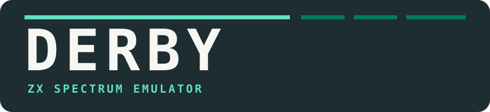
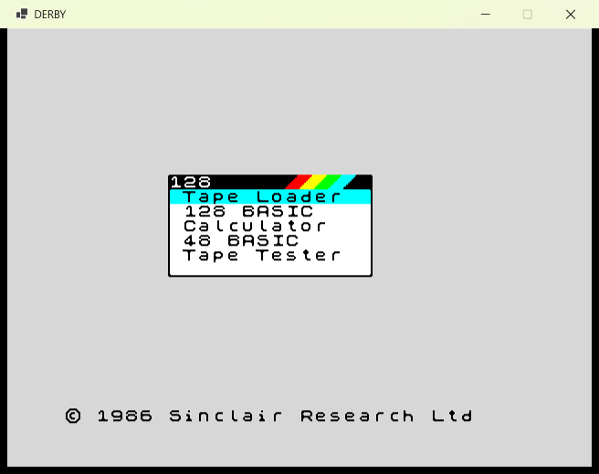
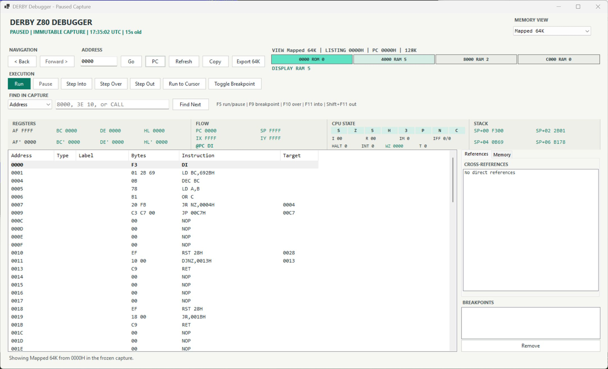
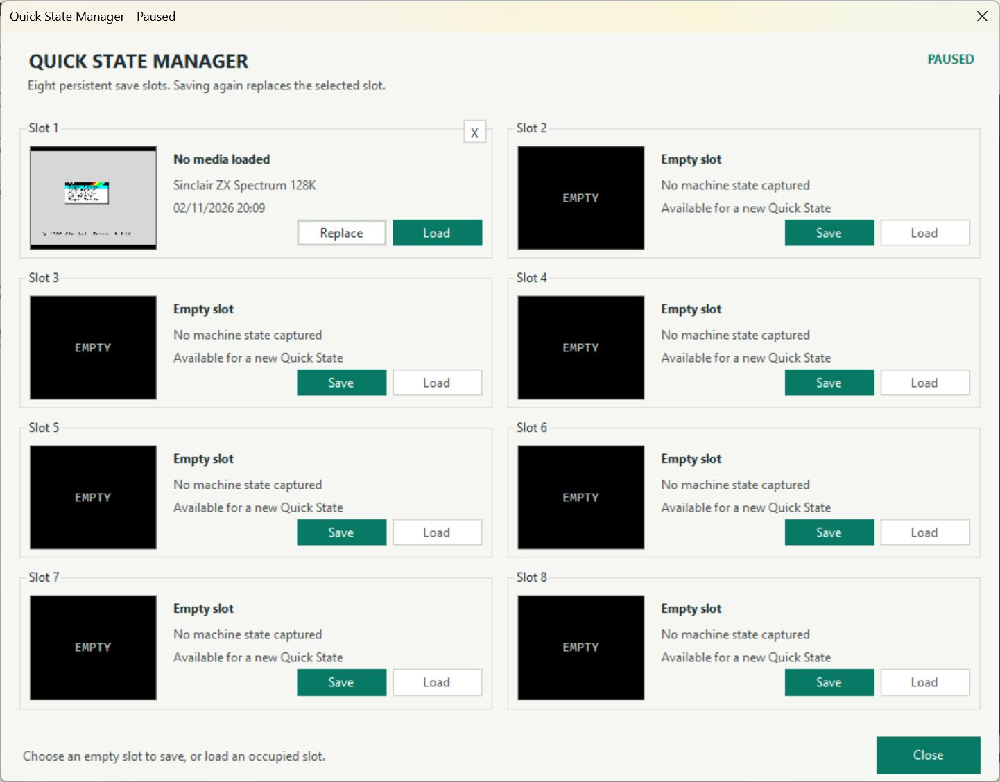

# DERBY



[](https://github.com/stevegr74/Derby-Spectrum-Emulator/actions/workflows/ci.yml)

**DERBY - ZX Spectrum Emulator**

A from-scratch ZX Spectrum emulator written in C# with no third-party runtime dependencies. The name honours Derby, the development codename used for Sinclair's Spectrum 128.

This project focuses on correctness, clean architecture, and incremental development, with strong validation through automated tests and Z80 compliance tooling.

---

## Features

- Z80 CPU with passing ZEXDOC and ZEXALL instruction groups
- Explicit 48K, 128K/grey +2, +2A, and +3 profiles with standard or `1FFD` special paging, keyboard matrix, interrupts, and a model-specific timing baseline
- Read-only +3 drive A: for standard and Extended CPC `.dsk` images, with native ROM loading
- Read-only +D drive 1 for `.mgt` images, using the bundled 8 KB G+DOS ROM
- Beam-latched Spectrum display with INK, PAPER, BRIGHT, FLASH, timestamped borders, and fixed 1x/Scale2x/Scale3x modes
- 48K beeper and AY-3-8912 tone, noise, envelope, and mixing through a clock-driven audio pipeline
- 48K/128K `.sna`, `.z80` v1/v2/v3, baseline `.szx`, and `.rzx` loading/replay
- `.tap` and `.tzx` parsing, fast bootstrap, ROM-driven loading, protected/mounted playback, VERIFY, and multi-block sequencing
- Tape Transport with named sections, persistent bookmarks, saved side pairing, stopped scrubbing and audio preview, rewind, and 48K stop-marker support
- Digital, Soft CRT (with an optional phosphor mask at 3x), and PAL TV presentation
- Modeless on-screen keyboard with selectable 48K rubber-key and 128K layouts, pointer holds, and Shift chords
- Optional Kempston or AMX Mouse with click-to-capture and Escape release
- Up to two simultaneous USB joysticks with independently selectable Kempston, Cursor, and game-facing Sinclair 1/2 mappings, stable per-device control profiles, automatic or explicit controller selection, live identification, and configurable raw-axis, hat, fire-button, and dead-zone mapping
- Platform-neutral headless core with Windows presentation/audio adapters
- Paused `F11` debugger with immutable mapped/physical-bank captures, a visual paging map, grouped CPU/stack context, execution controls, breakpoints, bank-qualified labels, control/data cross-references, hexadecimal memory inspection, persistent code/data markings, search, navigation, copy, and export
- Paused `F10` Quick State Manager with eight persistent slots, thumbnails, metadata, and live-session restoration (unavailable on +3 or while +D is attached)
- Paused Poke Manager with an editable validated library, checksum-aware suggestions, mapped or physical-bank one-off writes, previews, and guarded restoration
- Headless manual diagnostics and Z80 compliance runners

---

## Screenshots

### DERBY 128K Startup



### Bank-Aware Debugger



### Quick State Manager



For operation and controls, see the [User Guide](docs/USER_GUIDE.md). UI changes should follow the [Design Language](docs/DESIGN_LANGUAGE.md).

---

## Current Status

`master` is a stable, playable baseline for the original 48K, 128K, grey +2,
+2A, and +3. It supports read-only +3 and +D disks.
It includes beam-aware video, clock-driven audio, resumable tape transport,
snapshot and replay loading, an on-screen keyboard, joystick and mouse support, the eight-slot Quick State Manager, a bank-aware
debugger, and a checksum-aware Poke Manager. ZEXDOC and ZEXALL pass in the
headless compliance runner, although no CPU suite proves every interaction with
the surrounding hardware.

Manually tested titles, formats, and reached checkpoints are tracked in
[Verified Games And Media](docs/VERIFIED_GAMES.md).

Current limitations and active work:

- +3 disk support is read-only and limited to drive A:. Formatting, full
  controller timing, and +3 Quick State are not supported. +2A has no drive.
- +D supports one read-only drive on 48K, 128K, and grey +2. Quick State is
  unavailable while +D is attached.
- Protected and custom tape compatibility continues to expand as new media is
  tested.
- Broader timing-sensitive software and subjective title-by-title audio
  comparison remain ongoing validation work.
- SZX snapshots with mouse peripheral state are not supported.

### Implementation Notes

- Fast tape bootstrap is capability-gated. Unsupported BASIC control flow falls
  back to the real ROM autorun path with the remaining tape mounted; unknown
  ROMs likewise use exact pulse/EAR playback instead of assumed internal
  addresses.
- Tape planning is format- and behavior-driven rather than title-specific.
  Header/data structure, BASIC semantics, physical pulse timing, stop markers,
  and ROM handoffs are preserved without consulting media names or game hashes.
- Protected playback and Quick State preserve precise tape pulse, EAR,
  loader-continuation, replay, machine-profile, paging, CPU, and peripheral
  positions.
- Model-specific ULA profiles drive contention, floating-bus fetches, frame
  timing, and raster mapping. The event-driven raster captures timed bitmap,
  attribute, border, and 128K shadow-screen changes.
- Audio is derived from emulated T-states without cumulative sample drift.
  Turbo loading suppresses host audio and resumes only after discarding an
  incomplete transition frame.
- The Z80 core models Q and WZ/MEMPTR behavior, full maskable/NMI interrupt
  state, general IM 0 bus instructions, and instruction-boundary frame
  overshoot, with focused regressions alongside ZEXDOC/ZEXALL.
- The background emulation loop owns mutable machine state; the UI consumes
  copied snapshots and uses nested pause leases for safe inspection or mutation.
- Windows keyboard and controller adapters produce platform-neutral input
  state. Matrix ownership, simultaneous Interface II input, RZX precedence,
  focus-loss cleanup, per-device controller profiles, USB-port reconnection,
  and host-state exclusion from Quick State are explicit.
- Snapshot loaders validate supported state before replacing the running
  machine and reject hardware they cannot represent. The Poke Manager similarly
  pauses before atomic writes and guards restoration against later program
  changes.
- Windows tools and dialogs share the documented DPI-aware design language
  while machine addresses, registers, instructions, and byte values remain
  monospace.

## Development Priorities

Active work remains deliberately incremental:

- Preserve the verified tape-loading baseline and investigate new media failures
  when they can be reproduced.
- Keep the verified-media matrix, focused regressions, and ZEXDOC/ZEXALL as
  compatibility gates throughout structural work.

---

## Architecture

The solution separates the platform-neutral emulator from the Windows frontend
and diagnostic tools:

```text
Derby/
|-- Derby.Core/                 net8.0 platform-neutral emulator
|   |-- Audio/                  AY, beeper, and emulated sample timing
|   |-- Debugging/              instruction-boundary execution control
|   |-- Disk/                   read-only +3 and +D drives, DSK and MGT parsing
|   |-- Input/                  Spectrum joystick interfaces and state
|   |-- Memory/                 model-specific paging state and address-slot mapping
|   |-- Pokes/                  poke validation, matching, apply, and restore
|   |-- Tape/                   transport, block timing, load planning, execution, and continuation
|   |   `-- Formats/            TAP/TZX parsers plus the isolated BASIC bootstrap engine
|   |-- Ula/                    timing profiles and beam-aware raster capture
|   `-- Z80/                    CPU execution and instruction decoding
|
|-- Derby.Windows/              net10.0 Windows frontend
|   |-- Audio/                  Windows audio pipeline and output adapters
|   |-- Disassembly/            debugger UI, analysis, memory inspection, and export
|   |-- Forms/                  main window, dialogs, and shared UI styling
|   |-- Host/                   background loop, pause ownership, and UI snapshots
|   |-- Input/                  Windows keyboard and USB-controller adapters
|   |-- Video/                  display scaling, presentation, and overlays
|   |-- Derby.Windows.csproj    Windows frontend project
|   `-- Program.cs              Windows application entry point
|-- Pokes/                      editable game/poke library and format guide
|
|-- Derby.Tests/                 Core unit and regression tests
|-- Derby.Windows.Tests/         Windows presentation and host tests
|-- Derby.ManualHarness/         Core-only diagnostic and capture tool
|-- Derby.Z80Compliance/         ZEXDOC/ZEXALL compliance runner
|
|-- assets/                      product branding assets
|-- docs/                        user, design, compatibility, and engineering guides
|-- ROMs/                        bundled system and +D ROM images
|-- test-assets/                 checked-in test programs and fixtures
|-- .editorconfig                repository formatting conventions
|-- Directory.Build.props        shared warnings-as-errors build policy
`-- README.md                    project overview, status, and roadmap
```

`Derby.Core` has no WinForms, `System.Drawing`, or Windows
audio-device dependency. The `net10.0-windows` frontend consumes Core for
emulation state and produces Windows-specific video and audio output. The
compliance runner, `Derby.Tests`, and manual harness depend only
on Core. Windows presentation, debugger UI, and host behavior are covered by
`Derby.Windows.Tests`. `MainForm` coordinates host actions while
`EmulationSession` owns the machine, synchronization root, background loop, and
audio-pipeline lifetime. Focused video components own transient tape and Quick
State feedback, including their timing, layout, and drawing rules. Core paging
state/address mapping, tape-block timing, ROM workspace definitions, and BASIC
bootstrap execution live outside the machine and TAP entry-point types.

---

## Running

Run the emulator from the repository root:

```text
dotnet run --project Derby.Windows
```

ROM files must be present in the `ROMs` directory copied beside the executable
(the project copies the repository's bundled `ROMs` folder automatically):

```text
ROMs/
```

Expected ROMs:

- `48.rom`
- `128-0.rom`
- `128-1.rom`
- `plus2-0.rom`
- `plus2-1.rom`
- `plus3-0.rom`
- `plus3-1.rom`
- `plus3-2.rom`
- `plus3-3.rom`
- `plusd.rom`: 8 KB G+DOS v1a firmware for the +D disk interface

The right-click `F3 - Machine` submenu presents hardware and firmware together:
the original 128K, original 48K, grey +2, +2A, and +3 are selectable.
Pressing `F3` resets and cycles in that order; the submenu selects one directly.
DERBY uses bundled system ROMs. The +2A and +3 share four-ROM and special
all-RAM paging, but only the +3 has a built-in disk controller.

Amstrad has granted permission to redistribute the Sinclair/Amstrad system
ROMs for emulator use but retains the copyright; see `ROMs/README.md`.
Datel retains the copyright to the bundled G+DOS firmware.

The emulator starts in fixed-size `2x Enhanced` mode. `F4` cycles 1x native
(`320x240`), Scale2x (`640x480`), and Scale3x (`960x720`). Right-click the
display, press the Windows Menu key, or use `Shift+F10` to open the context
menu. Its controls appear in function-key order, followed by actions without
function-key assignments.

| Key | Action |
| --- | --- |
| `F1` | Open the control reference; emulation pauses while it is open |
| `F2` | Toggle the status overlay: FPS, machine profile, tape state, display size, and filter |
| `F3` | Reset and cycle 128K, 48K, grey +2, +2A, and +3 machine profiles |
| `F4` | Cycle fixed display size |
| `Shift+F4` | Cycle display filters |
| `F5` | Play, stop, or resume the inserted tape without ejecting it |
| `Shift+F5` | Open Tape Transport |
| `F6` | Load a `.tap` or `.tzx` tape as a new game |
| `F7` | Insert or change tape without resetting; press Play or `F5` when ready |
| `F8` | Open Disk Drive for read-only +3 `.dsk` and +D `.mgt` images |
| `F9` | Load a `.sna`, `.z80`, or `.szx` snapshot, or play an `.rzx` recording |
| `F10` | Open the paused eight-slot Quick State Manager (unavailable on +3 or while +D is attached) |
| `F11` | Open the debugger and disassembler, paused on an immutable machine capture |
| `F12` | Save a machine diagnostic dump and briefly show an on-screen badge |
| `Shift+F12` | Open Debug Dumps to open saved reports or locate them in File Explorer |

The right-click menu mirrors these actions, offers direct machine and display
selection, and adds Keyboard, Joystick, Mouse, and the Poke Manager. The debugger,
Quick State Manager, and inspection dialogs pause through nested-safe leases.
See the [User Guide](docs/USER_GUIDE.md) for complete operation, tape transport,
controller mapping, persistent Quick State, poke, and debugger instructions.

---

## Tests

Run all tests:

```text
dotnet test
```

GitHub Actions builds the complete solution on Windows, runs both automated test
projects, and then runs the checked-in ZEXDOC and ZEXALL programs through the
headless compliance runner. TRX diagnostics are retained for every CI run.

Test coverage includes:

- CPU instruction behaviour
- Memory paging
- Keyboard matrix
- FLASH timing
- Renderer correctness
- ROM boot smoke tests
- +2A four-ROM selection, every special all-RAM map, partial port decoding, paging lock, Quick State, and production-ROM boot coverage
- Focused opcode regression tests
- Snapshot loading
- Poke-library schema, checksum/alias matching, mapped and physical-bank application, guarded restoration, and STA WinForms interaction
- Tape parsing
- TZX parsing
- RZX replay parsing
- VERIFY handling
- Tape sequencing and reset behaviour
- banked tape-loader regression coverage
- Tape transport pause/resume and 48K stop-marker behaviour
- 48K/128K machine-model behavior
- complete 48K/128K contention phases, boundaries, I/O cases, and contended-bank behavior
- 48K/128K floating-bus fetches, including 128K shadow-screen bank selection
- exact port event timestamps, block-I/O timing, and border latch/raster mapping
- timed opcode, prefix, immediate, ordinary, indexed, block, stack, interrupt-vector, and IM 0 data-bus instruction cycles
- AY register write and selected-register port-read behaviour
- Audio sample generation, long-run 48K/128K sample-clock drift, and clipping diagnostics
- Audio pipeline behaviour, including turbo suppression, clean frame-boundary resume, and Quick State transition restoration
- Z80 instruction decoding, bank-aware disassembly navigation/search, paging-map presentation, grouped CPU-state changes and address links, labels, classifications, control/data cross-references, hexadecimal memory inspection, listing export, settings, snapshot behavior, and STA WinForms interaction
- Quick State deterministic machine, tape-cursor, RZX-cursor, eight-slot archive, metadata, thumbnail, corruption handling, and frontend restoration behavior
- ZEXDOC and ZEXALL compliance validation via the dedicated runner

ZEXDOC and ZEXALL are used separately for full CPU validation.

---

## Snapshot Support

Current snapshot status:

- `.sna`
  - 48K file-format loading implemented and verified
  - 48K-format snapshots retain the authentic 48K memory map and timing; selecting 128K keeps compatible external AY audio available without changing CPU/ULA timing
  - 128K file-format loading restores all RAM banks, paging state, and the explicit program counter
  - standard and duplicate-current-page 128K layouts are supported; TR-DOS snapshots are rejected because no TR-DOS ROM is emulated
  - a converted 128K Renegade snapshot has passed exact representable-state round-trip comparison and an execution smoke test
  - interrupt state restored from snapshot header semantics
  - generic format-based load path in use

- `.z80`
  - v1 loading implemented
  - v2/v3 page-block support implemented
  - 128K paging and RAM-bank restoration supported for applicable v2/v3 snapshots
  - interrupt state and interrupt mode restored from snapshot metadata
  - 48K-layout v1/v2/v3 snapshots retain 48K memory and timing; selected 128K mode or the extended-header Melodik flag provides compatible AY audio, while unsupported Fuller routing is rejected

- `.szx`
  - SZX 1.x loading implemented for exact 48K and original 128K machine IDs
  - restores CPU registers and execution state, RAM, frame phase, ULA state, 128K paging, and AY registers
  - accepts compressed or uncompressed RAM pages, arbitrary chunk order, and unknown optional metadata
  - validates the complete snapshot before changing the machine
  - supports 48K Melodik/128-compatible AY state and dormant unpaged Multiface metadata; rejects Fuller AY routing, paged Multiface memory, unsupported machine models, alternate timing, Issue 2 behavior, and other unsupported peripherals rather than approximating them
  - restores the SZX `WZ/MEMPTR` field alongside the documented CPU and execution state
  - self-contained 48K and 128K construction, load, and execution smoke tests cover the supported subset

The `F9` picker loads `.sna`, `.z80`, and `.szx` snapshots and plays `.rzx` recordings. It shows both groups by default and offers separate **Snapshots** and **Recordings** filters.

RZX replay accepts embedded SNA, Z80, and SZX start snapshots. The loader uses
the last snapshot before recorded input begins and ignores later checkpoint
snapshots as initial state.

---

## Manual Harness

A simple headless harness is included for debugging:

```text
dotnet run --project Derby.ManualHarness
```

This runs the emulator without UI and logs state.

Its generic diagnostics accept `frames=`, `model=48|128`, `quiet=1`, `audioanalysis=1`, `dumpblocks=1`, `strategy=`,
scheduled key/register/memory/tape-replacement events, memory-write watches, instruction traces, and
execution breakpoints. It writes a machine dump and BMP frame image only for the run being
investigated; audio analysis reports generated frame/sample counts, nonzero samples,
peak, RMS, clipping, and maximum adjacent-sample delta. Game-specific probes are
deliberately kept out of the harness.

Schedule mouse input with repeatable `mouse=frame:dx:dy:buttons` arguments
(right/up are positive; button bits are 1=right, 2=left, 4=middle). These events
default to Kempston Mouse. Use `mouse=amx` to start with AMX, or schedule changes
with `mousetype=frame:off|amx|kempston`.

The [ULA timing validation runbook](test-assets/ula/README.md) records how the
48K/128K Timing Test and floating-bus diagnostics are run without redistributing
their GPL-licensed media.

The headless harness also supports a read-only +D drive with the 8 KB
G+DOS ROM and 80-track double-sided `.mgt` images. On original 128K, choose
`128 BASIC` and type `RUN` to start a disk with `+SYS` and `AUTO`:

```text
dotnet run --project Derby.ManualHarness -c Release -- disk.mgt model=128 plusdrom=ROMs/plusd.rom quiet=1 frames=3600 "120:down:down,125:down:up,133:enter:down,138:enter:up,246:r:down,251:r:up,259:u:down,264:u:up,272:n:down,277:n:up,285:enter:down,290:enter:up"
```

This is a polled WD1772 subset for drive 1, not a full controller model.
In Windows, use `F8` for the same images and firmware. See the
[User Guide](docs/USER_GUIDE.md#d-disk-images) for first use and disk swaps.

> Intended for debugging, not performance measurement.

---

## Z80 Compliance Runner

A dedicated headless runner is included for CPU validation:

```text
dotnet run -c Release --project Derby.Z80Compliance -- test-assets/z80/zexdoc.com 7000000000
```

Notes:

- Runs ZEXDOC and ZEXALL in a minimal CP/M-style environment
- Fully uncapped execution
- Used for correctness validation, not timing accuracy
- All instruction groups currently pass

---

## Roadmap

Milestone numbers record delivery order. Completed milestones remain regression
baselines, not claims of universal compatibility.

| Milestone | Status | Outcome |
| --- | --- | --- |
| 1 | Complete | Active-low keyboard matrix, scan-aware Windows input, shared chord ownership, 128K menu navigation, and BASIC entry |
| 2 | Complete | Attribute/FLASH rendering and renderer optimization |
| 3 | Complete | 50Hz pacing, frame execution, and interrupt cadence |
| 4 | Complete | ZEXDOC/ZEXALL CPU baseline, hardware-derived block-I/O flags, Q-latch and interrupt semantics, and general IM 0 bus-instruction execution |
| 5 | Complete | 48K/128K `.sna` plus `.z80` v1/v2/v3 support |
| 6 | Complete | Verified TAP/TZX loading baseline: structure-driven bootstrap, native ROM fallback, protected playback, and manual and automatic multi-load handoffs |
| 7 | Complete | Clock-driven beeper/AY synthesis, mixing, and clean turbo-to-real-time audio handoff |
| 8 | Complete | Headless core/UI split and clock-driven audio buffering |
| 9 | Complete | Initial ULA contention, floating-bus, and timestamped border baseline |
| 10 | Complete | Side-effect-free Z80 decoder foundation |
| 11 | Complete | Explicit resettable 48K/128K machine modes |
| 12 | Complete | Resumable tape transport and TZX 48K stop markers |
| 13 | Complete | Paused read-only mapped-64K disassembler window |
| 14 | Complete | Deterministic temporary in-memory Quick State |
| 15 | Complete | Disassembler history, search, navigation, persistence, copy, and export |
| 16 | Complete | Central ULA profiles, contention conformance, 128K floating bus, exact port events, border-latch mapping, timed CPU bus cycles, and published diagnostic validation |
| 17 | Complete | Event-driven beam capture for bitmap, per-line attributes, border timing, and 128K shadow-screen changes, validated against Arkanoid and published diagnostics |
| 18 | Complete | Instruction-boundary Run/Pause, Step Into/Over/Out, run to cursor, CPU context, and persistent breakpoints |
| 19 | Complete | Bank-aware inspection, labels, conservative control/data cross-references, persistent code/data marking, and hexadecimal memory navigation |
| 20 | Complete | Tape state ownership, transition coverage, structured diagnostics, and behavior-preserving subsystem decomposition |
| 21 | Complete | Bank-aware Poke Manager with one-off writes, guarded restore, and a maintainable game catalogue |
| 22 | Complete | Two-channel USB joystick input with selectable Kempston, Cursor, and Interface II mappings, per-device profiles, stable hardware matching, and live identification through a Windows-only host adapter and platform-neutral core state |
| 23 | Complete | Bounded SZX loading for supported 48K and original 128K machine state, with explicit rejection of unsupported models and peripherals |
| 24 | Complete | Modeless 48K/128K on-screen keyboard with scan-aware holds, Shift chords, and keyboard-accessible layout selection |
| 25 | Complete | Kempston and AMX Mouse with Windows pointer capture, touchpad support, and software validation |
| 26 | Complete | 48K/128K/grey +2/+2A/+3 profiles and verified read-only +3 drive A: |
| 27 | Complete | Design-language Quick State Manager with eight persistent slots, metadata, thumbnails, and combined save/load access |
| 28 | Complete | Tape Transport v1: named sections, session bookmarks, rewind, and stopped side changes |
| 29 | Complete | Read-only +D drive 1: G+DOS boot and live `.mgt` swaps through F8, separate from the +3 drive |
| 30 | Complete | Persistent Tape Transport bookmarks keyed to the tape image |
| 31 | Complete | Saved tape side pairing and manual, stopped swaps without resetting the game |
| 32 | Complete | Stopped tape scrubbing and a host-only audio preview |
| 33 | Complete | Digital, Soft CRT, and PAL TV display filters with independent size and filter shortcuts |

Detailed completion evidence is retained in [Milestone History](docs/MILESTONE_HISTORY.md).

---

## Longer-Term Improvements

- Broader +D controller and disk compatibility beyond read-only drive 1. Reference: [MGT filesystem](https://sinclair.wiki.zxnet.co.uk/wiki/MGT_filesystem).
- Demo compatibility beyond the current validation matrix
- Broader real-game validation. The partial Ninja Warriors tape variants and
  Monkey Island gameplay-triggered +D disk swap remain parked; see
  [Verified Games And Media](docs/VERIFIED_GAMES.md).
- Extend PAL TV validation from a documented 128K composite ROM-menu photograph to a calibrated capture of the full colour range and transitions. The filters are visual approximations, not measured composite or RF signal models.
- Optional game library window with searchable artwork tiles, recent items, and an explicit file picker; prefer a scalable grid over a carousel-only interface
- Additional platform frontends, including a browser/WebAssembly adapter using the established headless engine boundary

---

## Design Principles

- No third-party runtime dependencies; xUnit and its runner are test-only packages
- Incremental development (no large rewrites)
- Behaviour verified with tests, ZEXDOC, and ZEXALL
- Clear separation between emulation and UI, with platform-neutral video and audio contracts
- Headless tooling for reproducible debugging

---

## Contributing

This is primarily a personal project for learning and development.

Contributions are welcome for bug fixes with tests. Feature changes should
align with the roadmap and be discussed before implementation.

See `CONTRIBUTING.md` for details.

---

## License

MIT
