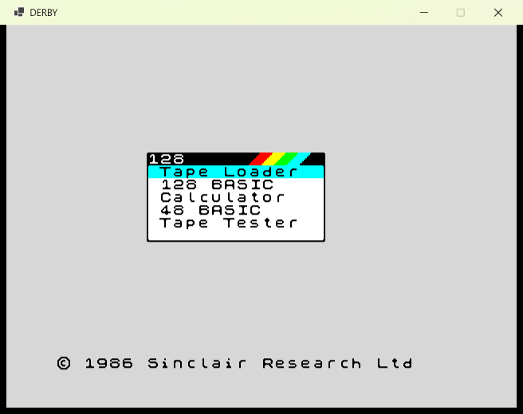
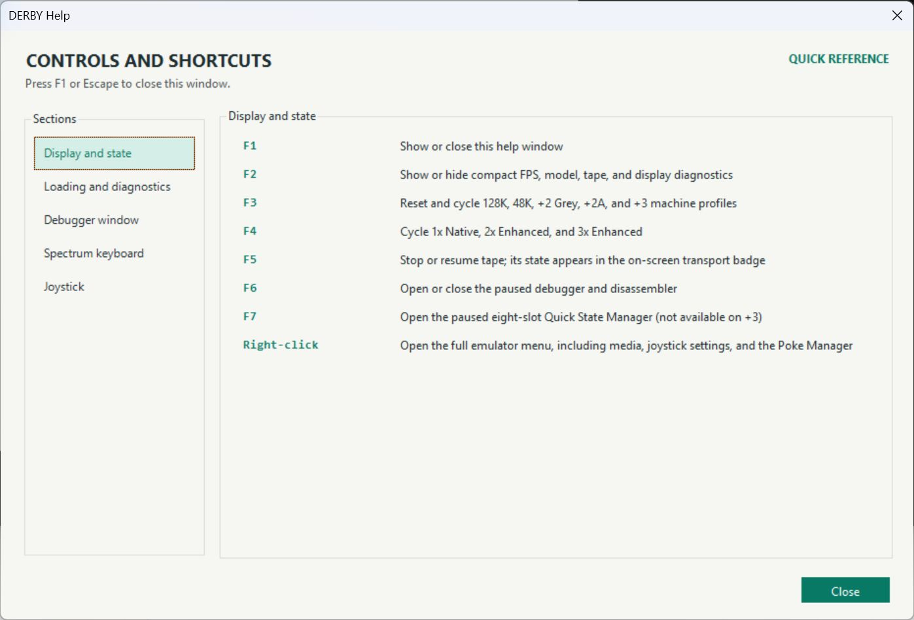
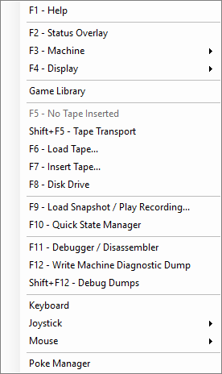
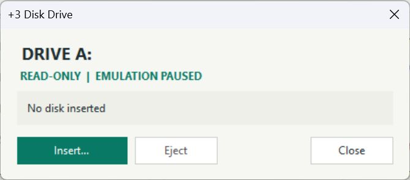
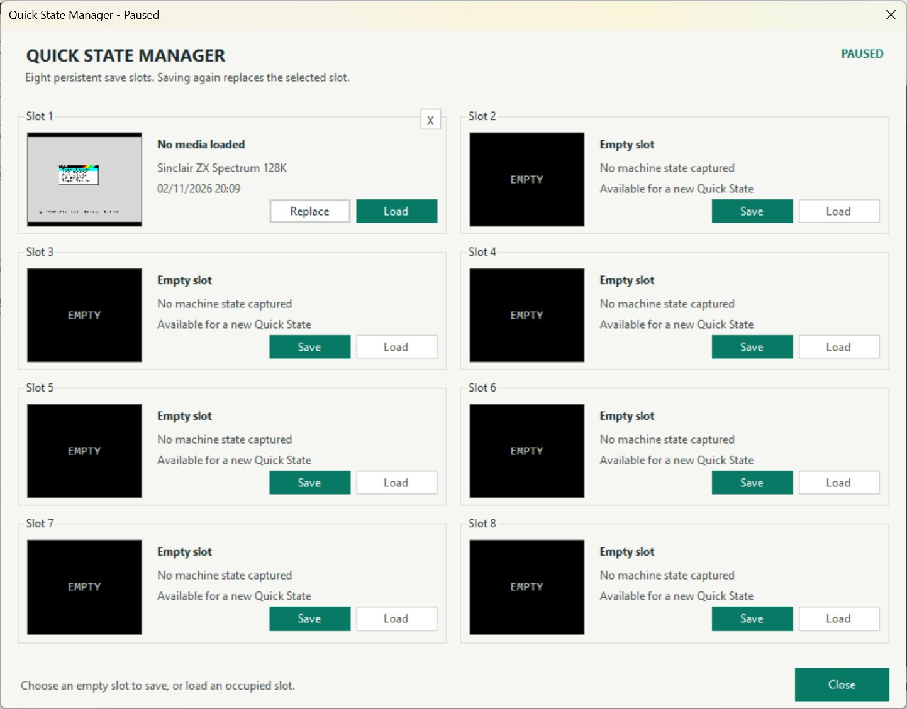
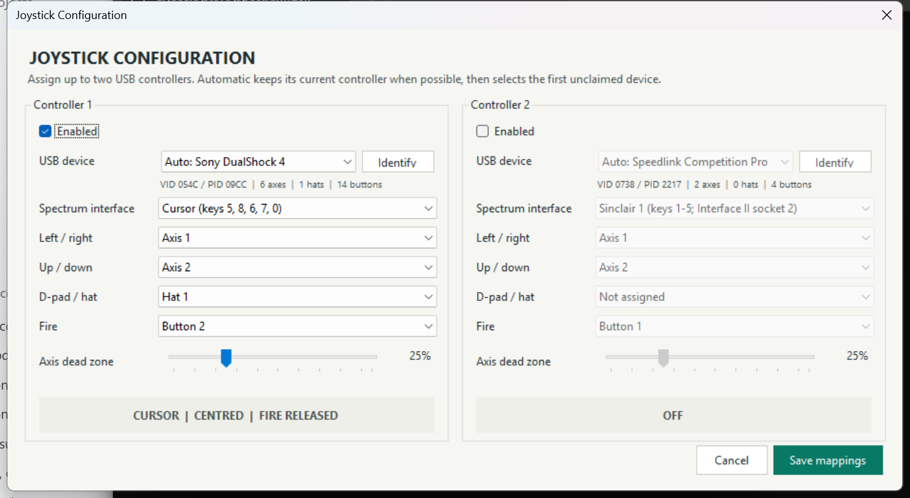
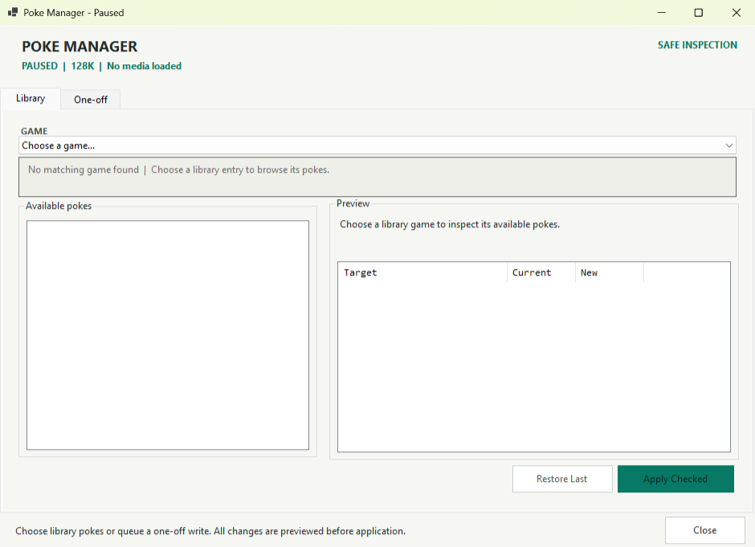
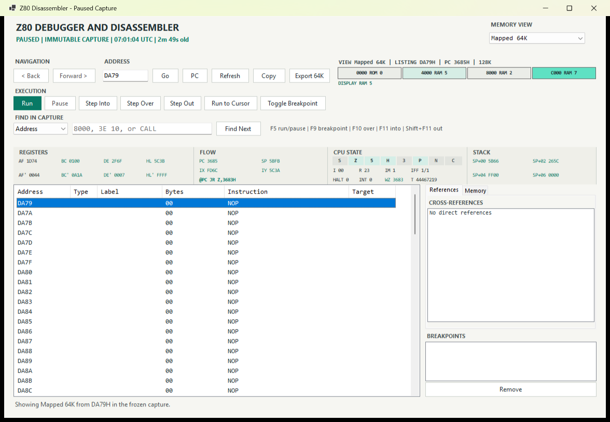

# DERBY User Guide

**Windows edition**  
**Covers:** 48K, 128K, grey +2, +2A, and +3 operation, snapshots, tape and disk images, Quick State, controllers, pokes, and debugging



This manual describes the emulator as it operates today. It begins with normal loading and play, then introduces the controller, Poke Manager, and debugger tools. Development status and architecture remain in [`README.md`](../README.md); tested software and reached checkpoints are recorded in [`VERIFIED_GAMES.md`](VERIFIED_GAMES.md).

> **Documentation note:** Screens and controls shown here are captured from the current Windows build. Planned features are identified explicitly and are not presented as available commands.

## Contents

- [Chapter 1 - Getting Started](#chapter-1---getting-started)
- [Chapter 2 - Main Controls](#chapter-2---main-controls)
- [Chapter 3 - Display And Status](#chapter-3---display-and-status)
- [Chapter 4 - Keyboard Input](#chapter-4---keyboard-input)
- [Chapter 5 - Snapshots And Recordings](#chapter-5---snapshots-and-recordings)
- [Chapter 6 - Tape Images And Multi-load Games](#chapter-6---tape-images-and-multi-load-games)
- [Chapter 7 - Quick State](#chapter-7---quick-state)
- [Chapter 8 - USB Joysticks](#chapter-8---usb-joysticks)
- [Chapter 9 - Poke Manager](#chapter-9---poke-manager)
- [Chapter 10 - Debugger And Disassembler](#chapter-10---debugger-and-disassembler)
- [Chapter 11 - Diagnostics](#chapter-11---diagnostics)
- [Chapter 12 - Troubleshooting](#chapter-12---troubleshooting)
- [Appendix A - Current Limitations](#appendix-a---current-limitations)

## Chapter 1 - Getting Started

The emulator models original Spectrum 48K hardware, original 128K/grey +2
hardware, +2A/+3 four-ROM paging, and a read-only +3 disk drive. The chosen model affects ROM behaviour,
memory, timing, sound, and how some games divide their tape content. Select the
intended model before mounting a tape.

### Requirements

- Windows with the .NET 10 desktop runtime, or the .NET 10 SDK when running from source.
- The bundled production ROM files in the `ROMs` directory:
  - `48.rom`
  - `128-0.rom`
  - `128-1.rom`
  - `plus2-0.rom`
  - `plus2-1.rom`
  - `plus3-0.rom` through `plus3-3.rom`

From source, start the emulator with:

```text
dotnet run --project Derby.Windows
```

The emulator starts as a Spectrum 128K in `2x Enhanced` display mode and shows the 128K ROM menu.

### Machine Profiles

Right-click the display and open **F3 - Machine** to choose:

- **ZX Spectrum 128K:** original 128K hardware and ROM pair.
- **ZX Spectrum 48K:** original 48K hardware and 1982 ROM.
- **ZX Spectrum +2 (Grey):** original 128K-family hardware and grey +2 ROM pair.
- **ZX Spectrum +2A:** the four-ROM +2A profile with normal and special all-RAM paging.
- **ZX Spectrum +3:** shared four-ROM paging with a read-only disk drive A:.

Pressing `F3` resets and cycles through 128K, 48K, +2 Grey, +2A, and +3 in menu
order. The submenu selects any profile directly. Changing profile clears the
loaded media. Custom ROM loading is not exposed.

### First Use

1. Press `F1` to open the built-in control reference.
2. Press `F8` for +3 disk images, `F9` or `F10` for snapshots or recordings, or `F11` for tapes.
3. Use the PC keyboard as the Spectrum keyboard, or configure a USB controller from the right-click menu.
4. Right-click the display whenever you prefer menus to function keys.

## Chapter 2 - Main Controls

The main window keeps permanent controls out of the Spectrum picture. Every command is available through a function key or the right-click menu.

### Built-in Help

Press `F1` to open the quick-reference window. Emulation pauses while it is open. Choose a category on the left, then use `F1`, `Escape`, or **Close** to return.



*Figure 2.1. Help groups display, loading, debugger, keyboard, and joystick controls.*

| Key | Action |
| --- | --- |
| `F1` | Open or close Help; emulation pauses while Help is open |
| `F2` | Show or hide the status overlay |
| `F3` | Reset and cycle 128K, 48K, +2 Grey, +2A, and +3 machine profiles |
| `F4` | Cycle 1x Native, 2x Enhanced, and 3x Enhanced display sizes |
| `F5` | Stop or resume the mounted tape |
| `F6` | Open or close the paused debugger and disassembler |
| `F7` | Open the paused eight-slot Quick State Manager (not available on +3) |
| `F8` | Open the read-only +3 disk drive dialog |
| `F9` | Load a `.sna` snapshot |
| `F10` | Load a `.z80` or `.szx` snapshot, or play an `.rzx` recording |
| `F11` | Mount a `.tap` or `.tzx` tape image |
| `Shift+F11` | Replace the mounted tape while preserving the running machine |
| `F12` | Write a machine diagnostic dump |
| Right-click | Open the complete context menu |

The context menu presents assigned function-key actions in order, with **Tape Transport...** next to F5. Keyboard, Joystick, Mouse, and the Poke Manager follow the function-key groups.



*Figure 2.2. Disk Drive (F8) starts the media group, followed by snapshot, replay, and tape commands. Unavailable actions remain visible but disabled.*

## Chapter 3 - Display And Status

### Display Size

`F4` cycles these fixed output sizes:

- **1x Native:** `320x240`
- **2x Enhanced:** `640x480`
- **3x Enhanced:** `960x720`

The enhanced modes use pixel-art scaling rather than smoothing the image as an ordinary photograph.

### Status Overlay

Press `F2` to show or hide compact mint diagnostics at the top-right. FPS, model, tape state, and display mode appear on separate right-aligned lines, moving below full tape feedback when necessary. The model line shows `+3` for the +3 and the 48K/128K timing family for other profiles.

### Window Title

When media is loaded, its filename appears in the window title. Tape transport state is deliberately kept in the on-screen badge and optional status overlay rather than permanently expanding the title.

### Tape Badge

Tape state changes appear at the top left of the emulated display:

- Full status text is shown for approximately three seconds.
- While tape is running, the display then reduces to a compact play icon.
- Paused, stopped, or ended indications disappear after approximately five seconds.
- Replacing tape media with a snapshot or recording clears the old tape indication immediately.

## Chapter 4 - Keyboard Input

The Windows frontend captures physical key messages before normal menu/control preprocessing and passes them to the emulated keyboard matrix on the emulation thread.

### Direct Keys

- Letters and numbers map to the corresponding Spectrum keys.
- `Enter` and `Space` map directly.
- PC `Shift` maps to Spectrum **CAPS SHIFT**.
- PC `Ctrl` or `Alt` maps to Spectrum **SYMBOL SHIFT**.
- Common punctuation is translated into the appropriate Spectrum SYMBOL SHIFT chord.
- Arrow keys generate the Spectrum cursor-key chords.

Shared Spectrum chords track each physical host key independently. Releasing one PC key will not incorrectly release a Spectrum modifier still owned by another held key.

### On-Screen Keyboard

Right-click the display and choose **Keyboard**. Use **48K rubber-key** or **128K** to change the key layout without changing the running machine. When the keyboard window has focus, **Page Up** selects 48K and **Page Down** selects 128K. The 128K layout has dedicated cursor, editing, and punctuation keys.

- Click a key to tap it, or hold the mouse button to keep the key down. Releasing the button ends the press, even if the pointer has left the key.
- Click **CAPS SHIFT** or **SYMBOL SHIFT** to arm it for the next key; click it again to cancel. To enter extended mode on the 48K layout, click both Shift keys in succession. The 128K layout also has a dedicated **EXTEND MODE** key.
- The emulator keeps running while the keyboard is open. Physical Spectrum keys still work when the keyboard window has focus. Losing focus, closing the window, or switching layouts clears on-screen holds and armed modifiers.
- The keyboard opens beside the display when there is room. You can move or resize it; DERBY remembers the layout and window placement. There is no separate function-key shortcut.

### Mouse

The mouse starts **Off**. Right-click the display and choose **AMX Mouse** or **Kempston Mouse** from the **Mouse** submenu to match the software you are running. Click inside the display to capture the current Windows mouse; the capture click is not sent to the Spectrum. Press `Esc` to release the pointer. Losing focus or opening a dialog also releases it.

DERBY uses one movement source per capture so the same motion is not counted twice. For touchpads that move the Windows pointer, movement is scaled to Spectrum pixels and sent as it arrives rather than batched. Release and recapture when switching pointing devices.

AMX Mouse and the Kempston joystick share a hardware port. While AMX Mouse is selected, it takes over that port. Choose **Off** or **Kempston Mouse** to use the Kempston joystick again without reconfiguring it.

Selecting a mouse in DERBY makes that interface available to the emulated Spectrum. If the software starts in keyboard or joystick mode, select the matching mouse driver in the software before capturing the pointer.

### Focus

Click the emulator display if a game is not receiving input after another dialog was used. Help, file choosers, Poke Manager, and the debugger deliberately pause or redirect keyboard focus while open.

## Chapter 5 - Snapshots And Recordings

Snapshots resume a stored machine state immediately; RZX recordings add deterministic recorded input. Loading any of these replaces the active program and clears old tape transport and badge state.

Loading new media resets tape transport and any tape badge left by the previous title.

### SNA Snapshots

Press `F9` and choose a `.sna` file.

Supported SNA state includes:

- Standard 48K snapshots.
- 128K snapshots with all RAM banks, paging state, and explicit program counter.
- The supported duplicate-current-page 128K layout.

TR-DOS snapshots are rejected because the emulator does not provide a TR-DOS ROM. A 48K-format snapshot always retains the 48K memory map and timing. When 128K mode is selected, compatible external AY audio remains available without applying 128K CPU or ULA timing.

### Z80 Snapshots

Press `F10` and choose a `.z80` file.

The emulator supports Z80 v1, v2, and v3 snapshots, including applicable 128K
paging and RAM-bank state. A 48K-layout snapshot keeps 48K memory and timing.
Selecting 128K mode provides compatible AY audio, while model-less extended
snapshots follow their Melodik metadata. Fuller AY port routing is rejected.

### SZX Snapshots

Press `F10` and choose an `.szx` file.

SZX 1.x snapshots for the exact 48K and original 128K models restore supported
CPU execution state, including the undocumented Z80 WZ/MEMPTR latch, RAM,
frame phase, ULA state, 128K paging, and AY state.
Both compressed and uncompressed RAM pages are accepted. The complete file is
validated before the running machine is replaced.

The debugger displays the restored latch as `WZ` in its CPU-state panel. The
latch is also preserved by Quick State so resumed execution retains its
undocumented flag and addressing behavior.

SZX can also describe hardware that this emulator does not provide. The
Melodik/128-compatible AY interface is supported for 48K snapshots, and dormant
unpaged Multiface metadata is harmless. Fuller AY routing, paged Multiface
memory, another Spectrum model, alternate timing, Issue 2 behavior, or another
unsupported peripheral is rejected with an explanatory message rather than
loaded inaccurately.

### RZX Recordings

Press `F10` and choose an `.rzx` recording. Embedded SNA, Z80, and SZX start snapshots are supported; when a recording contains later checkpoint snapshots, the last snapshot before recorded input begins is used as the initial state. Recorded input has priority over live joystick port input so replay remains deterministic. Quick State also preserves the replay position.

## Chapter 6 - Tape Images And Multi-load Games

Tape images reproduce a loading process rather than a finished machine state. The emulator accelerates only the loader paths it can represent safely and falls back to ROM/pulse loading for ambiguous or protected sequences.

Press `F11` and choose a `.tap` or `.tzx` image.

For a multi-side release, press `Shift+F11` when it's time to change sides, or
open **Tape Transport...** and choose **Change tape** from **Choose tape...**.
The replacement stays stopped without resetting the running game. Go to the
required section if needed, then press Play or `F5`.

### Automatic Loading

The emulator selects a loading strategy from the tape structure:

- Safe, understood bootstrap programs may be accelerated.
- Unsupported or ambiguous loader control flow falls back to the real Spectrum ROM path.
- Protected and custom loaders can continue from exact pulse/EAR state.
- Multi-load games may pause and resume between sections.

This selection is generic. It does not depend on game filenames or title-specific hashes.

### 128K And 48K Behavior

Many games use different loading behavior by model:

- A 128K version may preload more content.
- A 48K version may stop after loading the current level and ask for the tape later.
- Some games marketed for both models still use a multi-load sequence on 128K.

Use `F3` before mounting the tape when you want to test the other machine model. Switching model resets the machine.

### Manual Tape Control

Use `F5` to stop or resume the mounted tape without ejecting it. Resume only when the game asks for more tape input.

The emulator also handles supported TZX pauses, stop markers, tape end, and detected loader handoffs automatically. A stopped tape remains mounted and can be resumed. Brief pulse-synchronization holds used by protected loaders remain internal, so they do not flash misleading stop/play feedback.

Right-click the display and open **Tape Transport...**, then click **Choose tape...**. If there's already a tape in the deck, **Change tape** is the default and keeps the running game. The replacement stays stopped, so you can go to a section or bookmark before pressing Play. Choose **Start new game** to reset the Spectrum and load the tape from the start. F11 still loads a new game, and Shift+F11 still changes the tape without resetting.

The progress bar shows named tape sections as dark ticks, your bookmarks as teal dots, and the last stop as an amber tick. When the tape is stopped, select a section or bookmark in the list or on the bar, then choose **Go to**. Only tapes with embedded names show sections. **Add bookmark...** names the current stopped position or a selected stop, and **Edit...** renames or deletes a bookmark. Rewinding and jumping leave the tape stopped and do not rewind the Spectrum.

Bookmarks reappear when you return to the same tape image during the session. The transport window itself does not pause the Spectrum.

### If A Multi-load Fails

1. Confirm the correct 48K/128K model was selected before mounting.
2. Wait for the game to request the next section.
3. If the game requests another tape side, press `Shift+F11` and select it.
4. After changing sides, choose the required position if needed, then press `F5` once to resume.
5. If the game immediately errors, do not repeatedly toggle transport; record the displayed error and media filename for diagnosis.

### +3 Disk Images

1. Press `F8` or choose **F8 - Disk Drive**, the first item in the right-click menu's media group. The dialog is available on every model and opening it does not reset the machine.
2. Choose **Insert** and select a `.dsk` image. If another model is selected, DERBY asks before switching to +3 and resetting. Declining leaves the current model and session intact.
3. Close the dialog and press Enter on **Loader** in the Spectrum +3 menu.



*Figure 6.1. The drive dialog pauses emulation and shows whether a disk is inserted.*

Drive A: is read-only. **Replace** and **Eject** work without resetting the +3.
Use **Replace** if a running game asks for a different disk. The dialog pauses
the emulator while open. Disks have no Play, Stop, Pause, or Rewind controls;
the +3 reads them directly. A small on-screen `A:` badge indicates access.
`F5`, `F11`, and `Shift+F11` still control tapes only.

## Chapter 7 - Quick State

Press `F7` to open the paused Quick State Manager. It provides eight persistent
slots in a compact two-column window with no scrolling.



*Figure 7.1. All eight slots remain visible without scrolling; empty slots cannot be loaded.*

Each slot shows a clean Spectrum-frame thumbnail, the loaded media name, the
captured machine profile, and the local capture date and time. Empty slots are
clearly labelled and cannot be loaded.

1. Choose **Save** on an empty slot to capture the current machine.
2. Choose **Load** on an occupied slot to restore it and close the manager.
3. Choose **Replace** to overwrite an occupied slot after confirmation.
4. Choose the small **X** in an occupied card's top-right corner to delete that slot after confirmation.
5. Choose **Close** or press `Escape` to return without changing machine state.

All eight slots are stored together in
`%LocalAppData%\Derby\quick-states.dat`. DERBY compresses the versioned archive
and replaces it atomically after a successful save, so application updates and
read-only installation folders do not endanger the slots.

Quick State restores CPU state, all RAM banks, paging, ULA/video state, audio
generation state, current media name, tape pulse/EAR and loader-continuation
position, and RZX replay position. It can survive loading different media or
switching machine profiles during the same emulator session, then reinstate the
captured ROM set and paging family before returning to the captured state.

After DERBY is restarted, a persisted slot restores CPU registers, RAM, paging,
machine profile, border/video-visible state, AY registers, and interrupt timing.
An in-flight external tape or RZX stream is not reopened automatically after a
restart; within the original session, the richer live slot still restores its
exact tape pulse/EAR, loader-continuation, and replay position.
If the tape had ended when you saved, it remains in the deck after a same-session
restore and can be rewound without resetting the Spectrum.

Live host details such as a controller connection are not stored as emulated machine state. Audio and input adapters are cleaned up when a state is restored.

## Chapter 8 - USB Joysticks

Right-click the display and open **Joystick**. Controller 1 and Controller 2
have separate status and selection submenus. Choose **Configure both
controllers...** for the full mapping window.

### Device Selection

- **Off:** disconnect that controller channel from the emulated machine.
- **Automatic:** keep the controller already serving that channel when possible. After reconnection, prefer the same hardware profile; otherwise use the first unclaimed controller.
- **Named device:** use that selected controller. If it moves to another USB port, reconnect it by its hardware profile rather than treating it as a new mapping.

Automatic channels claim different devices, and the resolved controller name is
shown in both the menu and configuration dialog. A named device is not replaced
by unrelated hardware if it disappears; unavailable input becomes neutral so no
direction or Fire remains stuck.

Windows does not expose a permanent serial number for every USB game
controller. DERBY therefore combines the hardware vendor/product IDs and the
reported control layout into a portable device profile. This preserves mappings
when a controller changes USB port. If two truly identical, serial-less devices
are moved at the same time, Windows cannot prove which physical unit is which;
use **Identify** or move a control while watching the live preview before saving.

### Spectrum Interface

Choose **Joystick > Configure both controllers...** and select the interface
expected by the game for each enabled channel:



*Figure 8.1. Two independent mappings support original dual-joystick software; each live preview verifies the selected interface and controls before **Save mappings** is used.*

- **Kempston:** active-high directions and Fire through port `1FH`.
- **Cursor:** directions and Fire through Spectrum keys `5`, `8`, `6`, `7`, and `0`.
- **Sinclair 1:** keys `1-5` (physical Interface II socket 2).
- **Sinclair 2:** keys `6-0` (physical Interface II socket 1).

The socket numbers on the original Interface II hardware run opposite to the
Sinclair 1/2 labels commonly presented by games. The configuration dialog shows
both names so that the selected option matches the game menu without hiding the
historical wiring.

For two-player Interface II software, enable both channels and assign one to
Sinclair 1 and the other to Sinclair 2. Two enabled channels cannot claim the
same USB device or Spectrum interface; the dialog explains the conflict rather
than saving an ambiguous setup.

The game must be configured for the same interface. For example, choosing Sinclair in the emulator will not operate a game menu configured for Kempston.

### Mapping

The configuration dialog lets you choose:

- Horizontal axis.
- Vertical axis.
- Optional D-pad/hat.
- Fire button.
- Axis dead zone.

Generic Windows controller names are replaced with a known product name where
available, with `VID/PID` and control counts shown beneath the selector. Select
**Identify**, then move a stick or press a button to confirm the physical device.

Move each controller and press Fire while the dialog is open. Its live preview
shows the interface, direction, and Fire state. **Save mappings** stores the
controller slots and reusable device profiles for the current Windows user.
Axis, hat, Fire, and dead-zone settings follow the device; enabled state and the
chosen Spectrum interface remain specific to Controller 1 or Controller 2.
Existing single-controller settings are retained as Controller 1 and Controller
2 starts disabled.

The default mapping is axes 1/2 as displayed by the UI, hat 1 where available, button 1, and a 25% dead zone. Device hardware may expose different counts or ordering, so use the preview rather than relying on labels alone.

## Chapter 9 - Poke Manager

Right-click the display and choose **Poke Manager...**. Emulation pauses while the manager is open.



*Figure 9.1. The Library tab combines matching, selection, preview, guarded application, and restoration in one paused workflow.*

### Library Tab

The shipped library is loaded from `Pokes/pokes.json`.

1. Load the game or snapshot first.
2. Open Poke Manager.
3. Review the match status.
4. Tick one or more named pokes.
5. Review current and replacement bytes in **Preview**.
6. Select **Apply Checked**.

An exact SHA-256 match is authoritative for that media image. A filename alias is only a discovery suggestion and is labelled accordingly. If nothing matches, the manager stays on **Choose a game...** rather than selecting an unrelated title.

### One-off Tab

Use this for a temporary manual write:

1. Choose **Mapped 64K** or **Physical RAM bank**.
2. For a physical write, choose the RAM bank.
3. Enter the address and byte value in hexadecimal or decimal.
4. Choose **Add Write**.
5. Review current and new values.
6. Choose **Apply Pending**.

Mapped addresses refer to the CPU-visible 64K address space. Physical-bank addresses refer to offsets in a selected 16K RAM bank. Do not substitute one for the other.

### Restore Last

The manager keeps a session-local restoration stack. **Restore Last** restores the previous bytes only if the running program has not changed an applied byte since the poke. Refusing restoration is intentional protection against overwriting newer game state.

The initial library provides one-time writes. Continuously frozen values and conditional trainers are not currently supported.

## Chapter 10 - Debugger And Disassembler

Press `F6` to open the debugger. The emulator pauses safely at an instruction boundary and presents an immutable capture.



*Figure 10.1. The debugger combines execution controls, paging, grouped CPU state, disassembly, references, memory inspection, and breakpoints.*

### Workspace

The debugger includes:

- Mapped 64K, every ROM bank in the selected profile, and all eight physical RAM banks.
- Current paging map and active display bank.
- Main and alternate registers.
- Individual flags, interrupt state, HALT state, the `WZ` latch, and T-states.
- Four stack words and the instruction at `PC`.
- Disassembly listing, targets, breakpoints, cross-references, and memory inspection.

Values changed since the previous stopped capture are highlighted in yellow. Active flags use a soft teal highlight.

### Execution

| Control | Shortcut | Action |
| --- | --- | --- |
| Run / Pause | `F5` | Run or request a pause at the next instruction boundary |
| Step Over | `F10` | Execute a call as one operation; otherwise step one instruction |
| Step Into | `F11` | Execute one instruction and stop |
| Step Out | `Shift+F11` | Run to the return address currently on the stack |
| Run to Cursor | `Ctrl+F10` | Run to the selected mapped instruction without adding a breakpoint |
| Toggle Breakpoint | `F9` | Add or remove a breakpoint at the selected mapped instruction |

The listing remains frozen while execution runs. It refreshes only after execution stops safely.

### Navigation

- Arrow keys move through listing rows.
- `Enter` follows a direct branch or call target.
- `Alt+Left` and `Alt+Right` move through address history.
- `Ctrl+G` focuses address entry.
- `Ctrl+P` returns to the captured program counter.
- `Ctrl+R` refreshes the capture while paused.
- Clicking PC or a stack value navigates the mapped listing.
- Clicking other address-valued registers opens the Memory tab.

### Search

Use `Ctrl+F` to focus search and `F3` to find the next match. Search can locate an address, byte sequence, or mnemonic text in the current capture and selected memory view.

### Memory Views

The **Memory View** selector distinguishes:

- Mapped 64K logical addresses.
- Individual ROM banks.
- Individual 16K RAM banks.

The four paging blocks show which ROM/RAM occupies `0000-3FFF`, `4000-7FFF`,
`8000-BFFF`, and `C000-FFFF`. This includes +2A and +3 all-RAM configurations. The
display-bank label identifies the RAM bank currently scanned by the ULA. The
summary retains the selected 48K, 128K, grey +2, +2A, or +3 profile name. Selecting
a physical ROM or RAM view highlights a paging block only when that bank is
actually present in the captured logical map.

### Memory Inspector

Open the **Memory** tab to inspect hexadecimal and ASCII bytes without changing the disassembly view. Sources include mapped memory and physical banks. Register, stack, listing, and direct-reference navigation can take you to relevant bytes.

### Labels And Classification

Use `Ctrl+L` or right-click the listing to:

- Add or edit a bank-qualified label.
- Mark selected ranges as code, data, or unknown.
- Inspect memory.
- Manage symbols.

Labels and classifications are scoped by media/model and persist between sessions. Confirmed data is shown/exported as `DB`, excluded from mnemonic search, and not recursively interpreted as code. Following an unlabeled direct branch or call can create an automatic label.

### Cross-references

The **References** tab lists conservative incoming and outgoing references for direct calls/jumps and absolute data reads/writes. Indirect accesses and arbitrary bytes are deliberately not guessed as code.

### Copy And Export

- `Ctrl+C` copies selected rows with capture metadata.
- `Ctrl+Shift+C` copies every displayed row.
- `Ctrl+E` exports the selected view: 64K for mapped memory or 16K for a physical bank.

## Chapter 11 - Diagnostics

Press `F12` to write a machine diagnostic dump. Use this when reporting a reproducible emulation problem; note the game/media filename, machine model, point reached, and visible error.

The optional `F2` overlay is useful for checking FPS, model, display, and tape state before collecting a dump.

## Chapter 12 - Troubleshooting

### A Tape Mounts But Nothing Appears

- Some protected loaders remain black for a while during real-time pulse playback.
- Confirm the tape badge says it is playing.
- Confirm the correct machine model was selected before mounting.
- Avoid pressing keys unless the loader or game requests one.

### A Game Requests More Tape

Press `F5` once. If loading fails immediately, capture the exact error rather than repeatedly stopping and starting the tape.

### A Game Loads With The Wrong Controls

- Check the game’s own selected control scheme.
- Match it to Kempston, Cursor, or Interface II in Joystick Configuration.
- Use the live preview to confirm directions and Fire.

### Keys Do Not Reach The Game

- Close or move focus away from Help, Poke Manager, debugger, or a file chooser.
- Click the emulator display.
- Confirm a joystick interface is not being mistaken for keyboard controls in the game menu.

### Sound Is Missing Or Distorted

- Verify whether the title is running in 48K or 128K mode; 128K AY music may not exist in a 48K version.
- Let accelerated tape loading finish before judging audio.
- Capture the media name, model, and exact point where sound differs.

### A Snapshot Is Rejected

- Confirm its extension matches the selected loader.
- Non-standard/truncated SNA files and unsupported TR-DOS state are rejected rather than guessed.
- SZX files for unsupported Spectrum models, timing variants, or peripheral hardware are rejected rather than approximated.

### Pokes Are Not Automatically Matched

- The loaded file may differ from the library’s exact checksum.
- A filename suggestion is not proof that addresses match.
- Use a validated library entry or enter a one-off poke only when you know the correct address space and value.

## Appendix A - Current Limitations

- SZX support currently targets exact 48K and original 128K machine state; peripheral-bearing snapshots and other Spectrum models are not yet supported.
- +3 emulates one read-only drive. Disk writes, formatting, and +3 Quick State are not supported.
- An on-screen 48K/128K keyboard is planned but not implemented.
- SZX snapshots that carry mouse peripheral state are not supported. Quick State preserves emulated mouse state but does not recapture the Windows pointer.
- Broader protected/custom TZX compatibility remains ongoing.
- The Poke library uses one-time writes rather than frozen/conditional trainers.
- Palette selection and CRT/composite-inspired presentation are planned; the current display uses the idealised digital palette.
- The current desktop frontend is Windows-only, although the emulator core remains platform-neutral.

For media known to work, partially work, or fail, consult [`VERIFIED_GAMES.md`](VERIFIED_GAMES.md).

